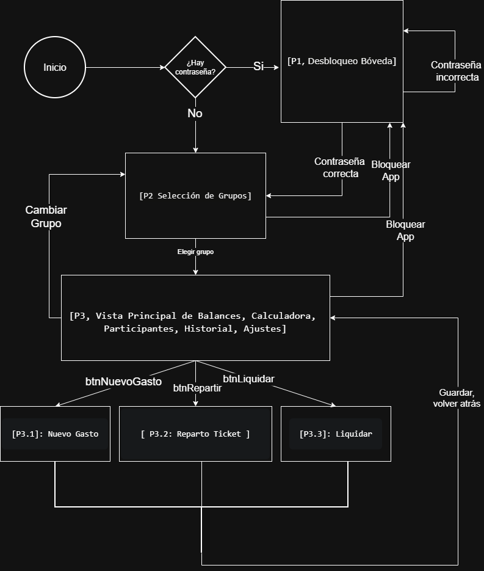
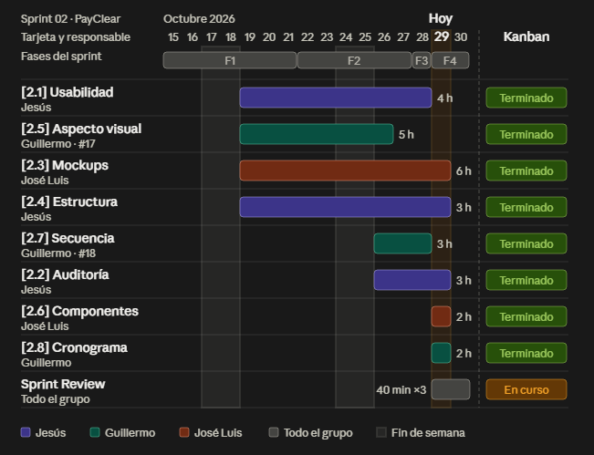

# PayClear - Documentación Técnica - SPRINT 2

* **Módulo:** Desarrollo de Interfaces (DII)
* **Equipo:** Jesús, José Luis, Guillermo
* **Fecha de entrega Sprint 2:** 30/10/2026

### **2.1. Usabilidad y accesibilidad: características, pautas y estándares**

#### **2.1.1. Atributos de usabilidad y formas de medirlo**

-   **Efectividad:** El programa garantiza que los gastos se guarden correctamente y que las cuentas cuadren al 100%. Además, la forma en que calcula las deudas asegura que los compañeros se hagan el menor número posible de pagos entre sí, evitando errores de cálculo.
-   **Eficiencia:** Cualquier usuario puede registrar un gasto en menos de 10 segundos y en solo 3 pasos. Esto se consigue porque toda la aplicación está en una sola pantalla principal y las pantallas emergentes para repartir tickets son muy sencillas.
-   **Satisfacción del usuario:** Buscamos una nota alta (más de 80 puntos sobre 100 en la encuesta de satisfacción estándar SUS). Esto se logra porque la aplicación no exige registrarse con correo electrónico, no tiene anuncios molestos ni pide pagos para usar sus funciones.

#### **2.1.2. Principios de diseño intuitivo**

1.  **Saber siempre qué está pasando:** En cuanto añades o borras un gasto, la pantalla actualiza los saldos de cada persona al instante y de forma automática, sin que tengas que darle a ningún botón de refrescar.
2.  **Estilo claro y conocido:** La aplicación se ve y funciona exactamente igual si la usas en un ordenador con Windows, Mac o Linux , utilizando botones e iconos sencillos que todo el mundo reconoce.
3.  **Evitar errores antes de que ocurran:** Si se te olvida poner cuánto ha costado la compra o intentas escribir letras en lugar de números, el botón de "Guardar" se queda deshabilitado para que no puedas cometer un fallo por despiste.
4.  **Fácil para todo tipo de usuarios:** Si prefieres usar el ordenador rápido, puedes hacer todo solo con la tecla Tabulador sin tocar el ratón. Si usas la pantalla táctil de un móvil, dispones de botones grandes y sencillos.

#### **2.1.3. Reglas de accesibilidad (Pensado para que lo use cualquier persona)**

La aplicación cumple con las normas oficiales de accesibilidad para programas informáticos (UNE-EN 301 549 y WCAG 2.1 Nivel AA):

-   **Colores fáciles de leer:** El texto y las letras destacan mucho sobre el fondo. Cumplimos con los niveles de contraste exigidos para que a nadie le cueste leer la información, incluso si tiene problemas de vista.
-   **Uso completo sin ratón:** Puedes controlar el 100% de la aplicación usando solo las teclas del ordenador (Tab para moverte y Enter para pulsar). Además, la casilla o botón donde estás situado se marca con un borde de color muy claro (*recuadro de foco*) para que nunca te pierdas.
-   **Pensado para lectores de pantalla**: La aplicación está adaptada para que las personas con discapacidad visual que usan lectores de voz (como NVDA en el ordenador o TalkBack en el móvil) puedan escuchar sin problemas qué hace cada casilla o botón.

#### **2.1.4. Aplicación práctica en PayClear: Diseño visual y tarjetas de colores**

-   **Aspecto moderno y adaptado:** Es la plantilla gráfica que usa el programa para que los botones y tablas se vean modernos, se adapten al tamaño de cualquier pantalla y marquen de forma clara el cursor al navegar con el teclado.
-   **Tarjetas de saldo fáciles de entender (Apto para personas daltónicas):** Para saber si debes o te deben dinero, la aplicación no usa solo el color, sino que combina color de alto contraste + texto claro + icono visual:
-   -   **Verde (Te deben dinero):** Fondo verde oscuro con letra blanca + Texto *"Le deben X €"* + Icono de sumar (+).
    -   **Rojo (Debes dinero):** Fondo rojo oscuro con letra blanca + Texto *"Debe X €"* + Icono de restar (-).
    -   **Gris (Cuentas al día):** Fondo gris oscuro con letra blanca + Texto *"Saldado"* + Icono de visto (✓).  

#### Fuentes y referencias normativas

**Accesibilidad Universal:** https://www.fundacionmdp.org/que-es-la-accesibilidad-universal/?gad\_source=1&gad\_campaignid=11414872512&gbraid=0AAAAACKtZL7u0IrytwlBJBalbZp5YXCNX&gclid=CjwKCAjwuobXBhBXEiwAYUaIlRBEWFZehm1t-2s5gvVYqseyS2xpmmzDNO0d3bmfGk5MpjtORRqT7xoCob0QAvD\_BwE

**Usabilidad para el diseño de interfaces de usuario:** https://www.nngroup.com/articles/ten-usability-heuristics/

**Guía de contraste de colores:** https://webaim.org/articles/contrast/

---
## 2.3. Seguimiento, modificación y documentación de los esquemas (Wireframes) y maquetas (Mockups)

> Fuentes: material de clase de la Unidad 1.2 (usabilidad, HCI y decálogo de Nielsen) y presentación de Willman.

### 2.3.1 ¿Qué teníamos antes y qué tenemos ahora?
- **Antes (Sprint 1):** bocetos rápidos en Figma para colocar botones y títulos.

- **Ahora (Sprint 2):** pantallas finales a color en Figma y su versión real en **Java Swing con FlatLaf**.

### 2.3.2 Fallos detectados y cómo los arreglamos
| Pantalla | Fallo detectado | Principio aplicado | Solución en la versión nueva |
|---|---|---|---|
| Acceso | Parecía un login web (correo y cuenta) y la app no usa internet | Nielsen 2: hablar el idioma del usuario | "Bóveda local bloqueada", solo contraseña, ojo para verla y aviso de modo offline |
| Inicio | Números sueltos; había que calcular de cabeza | Nielsen 8: diseño minimalista · HCI: visibilidad | Tres tarjetas (Te deben / Debes / Saldo neto), últimas compras y calculadora en la misma pantalla, y botón "Registrar gasto" con atajo Ctrl+N |
| Participantes | Verde/rojo solo por color: problema con daltonismo | Accesibilidad · Nielsen 5: reconocer antes que recordar | Etiqueta "Acreedor"/"Deudor" más el signo + o − |
| Gastos | Lista liada: no se veía quién pagó a quién | Nielsen 3: control y libertad | Ventana emergente (Me debe / Le debo) que se cierra con Esc |
| Historial | Lista de texto y no se sabía si se había guardado | Nielsen 1: visibilidad del estado · HCI: retroalimentación | Tarjetas por movimiento con "Pendiente", barra inferior de estado y avisos |

**Figma frente a Swing (lo que cambió al maquetar):**
| Aspecto | Figma | Swing + FlatLaf |
|---|---|---|
| Sombras y esquinas | Sombras y esquinas redondeadas | Esquinas rectas y sin sombras |
| Calculadora | "Todos (3)" + "Dividir al instante" | Concepto, pagado por y casillas de "Dividir entre" |
| Menú lateral | Con "Calculadora" | Sin ella: está integrada en Inicio |
| Barra inferior | No existía | Estado de la bóveda y atajo de ayuda F1 |

### 2.3.3 ¿Qué es FlatLaf y por qué mejora el proyecto?
FlatLaf es una librería gratuita que da a Swing un aspecto moderno y plano, como las apps actuales (con modo claro y oscuro). No cambia lo que hace la app, solo cómo se ve. Con ella:
- Todas las pantallas se ven iguales (**consistencia**).
- Botones y campos reaccionan al pasar el ratón o al seleccionarlos (**retroalimentación**).
- El texto se ve nítido y con buen contraste (**accesibilidad**).
- El estilo se activa en un solo sitio, así que es fácil de mantener.

### 2.3.4 Herramientas usadas
Figma (wireframes y mockups) · NetBeans con su diseñador (maquetación) · Java Swing · FlatLaf y FlatLaf Extras 3.7.2 · JDK 26 · GitHub (issues y seguimiento).

### 2.3.5 Justificación basada en Usabilidad, Accesibilidad y HCI
* **Usabilidad:** La aplicación elimina la fricción cognitiva y permite al usuario alcanzar su objetivo rápidamente (registrar y saldar cuentas). Se han integrado atajos de teclado (como `Ctrl+N` para nuevos gastos) y una calculadora en la pantalla de Inicio para evitar la navegación innecesaria.
* **Accesibilidad:** La información crítica nunca recae únicamente en el color. Las deudas y créditos se diferencian mediante colores (verde/rojo), símbolos matemáticos explícitos (+ y -), y etiquetas de texto descriptivas ("Deudor" / "Acreedor").
* **HCI (Interacción Persona-Ordenador):**
  * *Visibilidad:* El estado del sistema es constante gracias a la barra de estado inferior que confirma que los datos están "sincronizados en local".
  * *Prevención de errores (Restricción):* El uso de menús desplegables para seleccionar "Pagado por" y *checkboxes* para elegir a los deudores evita que el usuario introduzca datos incorrectos manualmente.
---

# 2.5 Pautas de aspecto: colores, fuentes, iconos, distribución

### 2.5.1. Colores y Accesibilidad (WCAG 2.1)
La paleta aplica los principios de **contraste, consistencia y accesibilidad** bajo el nivel **AA de la norma WCAG 2.1**. Para usuarios con daltonismo, los estados financieros incluyen siempre signos (`+` / `−`) y etiquetas explícitas (`Te debe` / `Le debes`) además del color:

* **Marca y cabeceras (`#173E34`):** Verde oscuro que aporta estabilidad, confianza y autoridad en los bloques principales y botones primarios.
* **Acreedor / Éxito (`#11734F` sobre `#EAF7F1`):** El verde es el color que el ojo procesa mejor y se asocia al dinero y al éxito (VERDE = EXITO); indica saldos a favor y confirmaciones.
* **Deudor / Alerta (`#B53C3C` sobre `#FFF0EE`):** Rojo desaturado para captar la atención en deudas pendientes y avisos de error sin saturar la vista.
* **Fondos y Textos (`#F3F6F4`, `#FFFFFF` y `#18201D`):** Lienzos claros y texto oscuro que aseguran la máxima legibilidad y limpieza visual.

### 2.5.2. Fuentes y Tipografía

Utilizamos **dos fuentes Sans-serif** para facilitar la lectura en pantallas digitales y mantener la consistencia:

* **`Manrope` (Semibold / ExtraBold):** Aplicada en títulos (`h1` a `h3`), logotipo y cifras monetarias para resaltar los importes y marcar la jerarquía visual.

* **`DM Sans` (Regular / Bold):** Empleada en el cuerpo de texto, menús, botones, formularios e historial por su alta legibilidad en tamaños pequeños (`11px` - `14px`).

### 2.5.3  ¿Qué es un archivo SVG?
Una imagen **SVG o Grafico Vectorial Escalable**, es un formato de archivo  basado en un lenguaje XML. A diferencia de los formatos rasterizados tradicionales compuestos por píxeles (JPEG, PNG...), los archivos SVG crean las imágenes mediante fórmulas matemáticas que describen puntos, líneas, curvas y formas geométricas sobre una cuadrícula en 2D. 

Las ventajas del formato SVG es que no pierde resolución ni nitidez al ser ampliado o reducido, se adapta de forma nativa a cualquier densidad de pantalla. 

### ¿Porqué hemos usado para el logo e iconos, imagenes SVG?

* **Independencia absoluta de la resolución:** Porque deben visualizarse de claramente en cualquier dispositivo y nivel de zoom, evitando así el verse pixelado o borroso que tienen formatos como el PNG o JPEG.

* **Optimización del rendimiento y ligereza:** Los iconos vectoriales en SVG tienen un peso en bytes minúsculo en comparación con imágenes rasterizadas más complejas, lo que minimiza los tiempos de carga de la interfaz y optimiza los recursos del sistema.

* **Interactividad y dinamismo visual:** El formato SVG es compatible con CSS y JavaScript, lo que permite aplicar efectos de movimientos, transiciones suaves y estados interactivos (como cambios de color o animaciones de trazo).

| Logo estático SVG (3 KB) | Logo animado SVG (5 KB) |
| :---: | :---: |
|  |  |

### 2.5.4. Distribución de Elementos

La maquetación organiza el espacio para conseguir tener una navegación intuitiva y sin sobrecarga la interfaz:

* **Diseño en cuadrícula y alineación:** Menú lateral fijo (`244px`) y área principal en doble columna (`CSS Grid`), ubicando los saldos a la izquierda y la calculadora rápida a la derecha (`360px`).
* **Jerarquía visual:** Un único punto de impacto principal arriba (`balance-hero`) con el saldo total del grupo, seguido del desglose en tarjetas.
* **Espaciado y modales:** Uso de espacios en blanco (`padding` y `gap` amplios) para evitar la saturación, aislando las tareas secundarias (nuevo gasto, liquidación, ajustes) en cuadros de diálogo modales (`role="dialog"`).

---

### **Fuentes:**

* Adobe. (s. f.). *Archivo : Qué es un archivo *. Adobe Creative Cloud. [https://www.adobe.com/es/creativecloud/file-types/image/vector/-file.html](https://www.adobe.com/es/creativecloud/file-types/image/vector/-file.html)

* Calou, J. (s. f.). *Guía: Cómo Animar con *. Toptal. [https://www.toptal.com/developers/front-end/guia-como-animar-con-](https://www.toptal.com/developers/front-end/guia-como-animar-con-)

 
* Jimdo. (2015, 10 de febrero). Cómo elegir los colores para tu página web. Jimdo Blog. https://www.jimdo.com/es/blog/colores-paginas-web/

* Torresburriel Estudio. (2022, 7 de febrero). WCAG 2.1: qué son y cómo respetarlas. Torresburriel Estudio Blog. https://torresburriel.com/weblog/wcag-2-1-que-son-y-como-respetarlas/

* Acosta Lugo, W. (2026). *UD01.2. Usabilidad: Unidad 4. Diseño de interfaces atendiendo a criterios de usabilidad* [Presentación]. Desarrollo de Interfaces, Campus Cámara Comercio Sevilla. [https://docs.google.com/presentation/d/1RENkac6LJWCK7VsLMN4KRsrvTlCqjNoHPTaZd8lSTQw/edit?usp=sharing](https://docs.google.com/presentation/d/1RENkac6LJWCK7VsLMN4KRsrvTlCqjNoHPTaZd8lSTQw/edit?usp=sharing)

* Alex, D. (2024, 10 de octubre). *Cómo elegir las fuentes para tu sitio web*. Squarespace Blog. [https://es.squarespace.com/blog/como-elegir-las-fuentes-de-un-sitio-web](https://es.squarespace.com/blog/como-elegir-las-fuentes-de-un-sitio-web)

---
## 2.6. Componentes reutilizables, controles de entrada, feedback y adaptabilidad

> Fuentes: material de clase de la Unidad 1.2 (usabilidad, HCI y decálogo de Nielsen) y presentación de Willman.

### 2.6.1. Componentes reutilizables
Repetimos los mismos bloques en toda la app para que el usuario los reconozca:
- **Tarjeta de saldo:** Aparecerá en verde te deben (acreedor) y en rojo si debes (deudor) y en gris si no hay deudas de ningún tipo.
- **Fila de lista:** tiene la misma estructura en grupos, participantes y movimientos.
- **Botones:** principal (verde oscuro, "Registrar gasto") y secundarios (con borde, "Saldar cuentas").
- **Etiquetas pequeñas:** "100% offline", "3 integrantes", "Acreedor/Deudor".
- **Medidas base:** márgenes internos iguales y bordes finos grises. En Figma las esquinas eran de 12–16 px, en Swing quedan rectas, algo que mejorar a futuro si lo vemos conveniente para la mejoría del aspecto de la aplicacion.

### 2.6.2. Consistencia en los controles de entrada
- Los importes llevan el símbolo **€** dentro del campo.
- Los campos tienen un texto de ayuda ("Mínimo 4 caracteres", "Ej. Cena, compra, taxi").
- La contraseña tiene un ojo para poder verla.
- "Pagado por" es un desplegable, y "Dividir entre" son casillas con estado claro: marcada con fondo verde.
- El foco y  el pasar el ratón por encima lo gestiona FlatLaf, igual en todos los controles de cada vista.

### 2.6.3. Retroalimentación visual
- Los botones y campos cambian al pasar el ratón o seleccionarlos.
- Los movimientos muestran su estado ("Pendiente") y la barra inferior informa del estado de la bóveda.
- Al ser una app **100% local no hay cargas**: la respuesta es inmediata. 

### 2.6.4. Adaptabilidad
- Todas las pantallas comparten estructura: menú lateral fijo y zona central que se ajusta al tamaño de la ventana.
- La app es de  escritorio,  la version para movil se realizara a futuro. (solo en Figma de momento).
---

## 2.7. Pautas de la secuencia de control de la aplicación

### 2.7.1. Modelo de flujo y navegación de pantallas

Para organizar cómo se mueve el usuario dentro de **PayClear**, planteamos un a de flujo donde cada recuadro corresponde a una pantalla del programa. Y para evitar repetir elementos comunes en la documentación, el **menú lateral fijo** se trata como un bloque independiente que se mantiene constante mientras cambia el contenido central.
#### 1. Secuencia lógica de uso y pantallas del sistema
* **`P1` - Pantalla de Desbloqueo de la Bóveda (`VistaBoveda`) [Condicional / Opcional]:** Esta pantalla solo aparecerá si el usuario ha pone una contraseña o cuando bloquea la sesión a propósito (desde P2 o P3). Si el grupo no tiene clave, la aplicación entra directamente a P2.
* **`P2` - Selección de Grupos (`VistaSeleccionGrupo`):** Es la vista donde se ven los archivos `.json` guardados en local (ej: *"Piso Nervión"* o *"Viaje Fin de Curso" ...*). Aquí se elige con qué grupo trabajar o si crear uno desde cero.
* **`P3` - Detalles y Balances (`VistaPrincipal`):** Es la pantalla principal donde se ve todo. A la izquierda agrupa el resumen superior (`balance-hero`), las tarjetas de saldo de cada amigo y el historialy los ajustes; a la derecha está fija la calculadora rápida para hacer las cuentas rapidamente sin cambiar de ventana.
* **`P3.1`, `P3.2` y `P3.3` - Ventanas Modales (`JDialog`):** Son pantallas emergentes para tareas concretas (meter un gasto nuevo, repartir un ticket detallado o ver el plan de liquidación). Tienen una relación bidireccional con `P3`: cuando se abren, bloquean el fondo para que el usuario no se distraiga y, al terminar o cancelar, siempre devuelven el control a la pantalla principal.
 

### 2.7.2. Gestión visual de errores y condiciones límite

La interfaz controla las entradas de datos en dos fases para evitar errores que descuadren las cuentas del grupo. Primero bloquea fallos comunes desde los propios controles y, si aun así falta algo, avisa en el mismo formulario.

Los botones de confirmación (`btnGuardar` en los modales o `Crear` al añadir un grupo) están desactivados mientras queden campos obligatorios en blanco. Y tampoco se pueden meter letras o signos negativos en las casillas de dinero: en Swing filtramos el texto con `DocumentFilter` o `JFormattedTextField`, y en el prototipo limitamos el campo con `type="number"` y `min="0"`.

Si el usuario intenta guardar un importe de `0,00 €`, poner una contraseña 4 o menos caracteres o repite el nombre de un grupo que ya existe, el programa avisa en el propio campo sin sacar ventanas emergentes (`JOptionPane`) que corten el paso. El borde de la casilla cambia a rojo (`#B53C3C` usando la propiedad `JComponent.outline` de FlatLaf) y debajo sale un texto corto con la etiqueta accesible `role="alert"` explicando qué pasa.

| Incidencia del usuario | Respuesta en pantalla | Implementación (Swing / Prototipo) |
| :--- | :--- | :--- |
| Escribir letras en el importe | El campo ignora las teclas y deja solo números y coma decimal (`0,00`). | Filtro de entrada numérica (`DocumentFilter` / `inputMode="decimal"`). |
| Importe negativo o a cero (`<= 0`) | Borde rojo (`#B53C3C`) y mensaje: *"Introduce un importe mayor que 0"*. | Propiedad `JComponent.outline = "error"` en FlatLaf y aviso inferior. |
| Dejar el concepto o nombre vacío | Botón de guardar desactivado (opacidad al 45%-60%) y cursor en el campo vacío. | `setEnabled(false)` conectado al `DocumentListener` del formulario. |
| Fallar la contraseña en Bóveda (`P1`) | Recuadro de aviso con fondo rosa claro (`#FFF0EE`), borde `#F3BDB8` y letras rojas (`#B53C3C`). | Mensaje con `role="alert"` y foco devuelto al campo de contraseña. |

### 2.7.3. Secuencia de actualización reactiva de la interfaz

En PayClear no hace falta darle a ningún botón de refrescar para ver los saldos al día. Cuando se guarda un cambio en cualquiera de las ventanas modales (`P3.1`, `P3.2` o `P3.3`), la pantalla principal se actualiza sola en cuatro pasos:

1. El controlador recoge los datos del modal, añade el movimiento a la lista y guarda los cambios en el archivo `.json` con **Gson** (o en `localStorage` dentro del prototipo).
2. El programa recalcula en memoria lo que te deben (`toReceive`), lo que debes (`toPay`), el saldo neto del grupo y los pagos mínimos del algoritmo voraz.
3. Al cerrarse el modal con `dispose()`, la vista `P3` cambia al momento las cifras del bloque superior (`balance-hero`), las tarjetas de los participantes y la tabla de movimientos. En Java Swing hacemos esto llamando a `revalidate()` y `repaint()` dentro del hilo de eventos (**EDT**). Como Swing dibuja los cambios primero en memoria (*doble búfer*) antes de volcarlos a la pantalla, la ventana no parpadea ni hace recargas raras.
4. Abajo a la derecha sale un aviso flotante durante 4 segundos (`role="status"`, con textos como *"Gasto añadido a pagos pendientes"* o *"Calculadora reiniciada"*) para confirmar que todo se ha guardado sin tapar la tabla.

### 2.7.4. Secuencia de salida y bloqueo seguro

Como la aplicación puede usarse en ordenadores compartidos de un piso de estudiantes, el botón **"Bloquear bóveda"** (o el atajo `Ctrl + L`) cierra la sesión al instante para que nadie cotillee las cuentas:

1. Si hay algúna ventana abierta, el programa lo cierra y destruye la ventana activa (`P2` o `P3`) con `dispose()`.
2. Se borra la marca de sesión activa (`sessionStorage` o la referencia del grupo cargado en la memoria RAM) y se limpian las variables temporales de los formularios.
3. La aplicación vuelve a la pantalla de bloqueo (`P1`) y coloca el cursor (`autoFocus`) directamente en la casilla de la contraseña.

### Fuentes utilizadas

* **Universitat Oberta de Catalunya (UOC).** *El diseño de la interacción: Los documentos a entregar (a de navegación y guión técnico)*. Materiales docentes multimedia en español: https://cv.uoc.edu/UOC/a/moduls/90/90_574b/web/main/m5/c4/3.html
* **Uifrommars** *Heurísticas de Nielsen: las 10 heuristicas de Nielsen:* https://uifrommars.com/10-reglas-heuristicas-como-aplicarlas/
* **Acosta Lugo, W. (2026), Desarrollo de Interfaces, Campus Cámara FP (EUSA) Sevilla.**  https://docs.google.com/presentation/d/1RENkac6LJWCK7VsLMN4KRsrvTlCqjNoHPTaZd8lSTQw/edit?usp=sharing.

# 2.8. Cronograma de ejecución

Para organizar el trabajo del **Sprint 02** (del 15 al 30 de octubre de 2026) nos hemos dividido las tareas entre los tres. Planificamos el esfuerzo en **horas reales de dedicación** y mantenemos una correspondencia exacta con las tarjetas abiertas en nuestro tablero Kanban de GitHub Projects.

## 2.8.1. Desglose real de trabajo por sesiones

1. **Fase 1 - Clases teóricas, reparto y arranque (15 oct - 21 oct):** Se repartieron las tarjetas en GitHub Projects. A partir del día 19, Jesús empezó con usabilidad y accesibilidad (`[2.1]`) y con el diseño estructural de menús, ventanas y atajos (`[2.4]`); Guillermo comenzó las pautas de aspecto (`[2.5]`); y José Luis empezo con los wireframes y mockups (`[2.3]`).
2. **Fase 2 - Aspecto visual y arranque de auditoría y secuencia (22 oct - 27 oct):** Guillermo cerró las pautas de aspecto el día 26, con la paleta accesible WCAG 2.1, las tipografías y los logos en SVG (`[2.5]`). Ese mismo día empezó la secuencia de control (`[2.7]`) y Jesús arrancó las métricas y herramientas de auditoría (`[2.2]`). Mientras tanto, Jesús y José Luis siguieron avanzando con `[2.1]`, `[2.4]` y `[2.3]`.
3. **Fase 3 - Cierre de secuencia y usabilidad (28 oct):** Guillermo terminó el diagrama de flujo de vistas (de `P1` a `P3.x`) y la documentación del punto `[2.7]`[cite: 2]. Jesús dejó cerrado el `[2.1]`.
4. **Fase 4 - Revisión cruzada, componentes y cierre del sprint (29 oct - 30 oct):** Revisión en grupo de lo redactado. Jesús aplicó las correcciones acordadas y cerró `[2.2]` y `[2.4]`; José Luis terminó de documentar los mockups (`[2.3]`) y completó las pautas de componentes visuales (`[2.6]`); y Guillermo cerró este cronograma (`[2.8]`). Entre el 29 y el 30 dejamos lista la presentación para la *Sprint Review*.

---

## 2.8.2. Asignación de recursos, tarjetas (GitHub Issues) y horas dedicadas

| Tarjeta / Entregable en GitHub Projects | Responsable | Inicio - Fin real | Horas |
| :--- | :--- | :---: | :---: |
| **`[2.1]`** Usabilidad y accesibilidad: características, pautas y estándares | **Jesús** | 19/10 - 28/10 | 4 h |
| **`[2.5]`** Pautas de aspecto: colores, fuentes, iconos, distribución | **Guillermo** | 19/10 - 26/10 | 5 h |
| **`[2.3]`** Seguimiento, modificación y documentación de wireframes y mockups | **José Luis** | 19/10 - 29/10 | 6 h |
| **`[2.4]`** Pautas de diseño estructural: menús, ventanas, diálogos, atajos | **Jesús** | 19/10 - 29/10 | 3 h |
| **`[2.7]`** Pautas de la secuencia de control de la aplicación | **Guillermo** | 26/10 - 28/10 | 3 h |
| **`[2.2]`** Medidas de usabilidad y accesibilidad; herramientas de auditoría | **Jesús** | 26/10 - 29/10 | 3 h |
| **`[2.6]`** Pautas para el desarrollo de componentes visuales | **José Luis** | 29/10 - 29/10 | 2 h |
| **`[2.8]`** Cronograma de ejecución | **Guillermo** | 29/10 - 29/10 | 2 h |
| **`[Sprint Review]`** Presentación y defensa del Sprint 02 | **Todo el grupo** | 29/10 - 30/10 | 40 min (x3) |

**Total por persona:** Jesús: 10 h · Guillermo: 10 h · José Luis: 8 h (más la preparación de la *Sprint Review*).

---

## 2.8.3. Diagrama de Gantt y sincronización con Kanban

* **Dependencias y revisión en equipo:** El trabajo se organizó con tareas en paralelo desde el 19 de octubre (`[2.1]`, `[2.3]`, `[2.4]` y `[2.5]`). Las dependencias directas son dos: las pautas de componentes visuales (`[2.6]`) necesitan tener definido el aspecto visual (`[2.5]`) y los mockups (`[2.3]`), y la *Sprint Review* depende de que todas las tarjetas anteriores estén cerradas. Antes de mover las tareas a *Terminado*, hicimos una revisión grupal que sirvió para pulir el punto `[2.4]` y alinear los textos con el prototipo final.
* **Estado del tablero Kanban (GitHub Projects):** Hoy jueves 29 de octubre, las tarjetas `[2.1]` a `[2.8]` están ya en la columna *Terminado*. Solo sigue en curso la tarjeta conjunta `[Sprint Review] Presentación` para la defensa de mañana viernes 30 de octubre.

 

---

# Fuentes utilizadas

* **Martins, J. (2026, 14 de agosto).** *Diagrama de Gantt: guía paso a paso, ejemplos y Excel*. Asana. https://asana.com/es/resources/gantt-chart-basics
